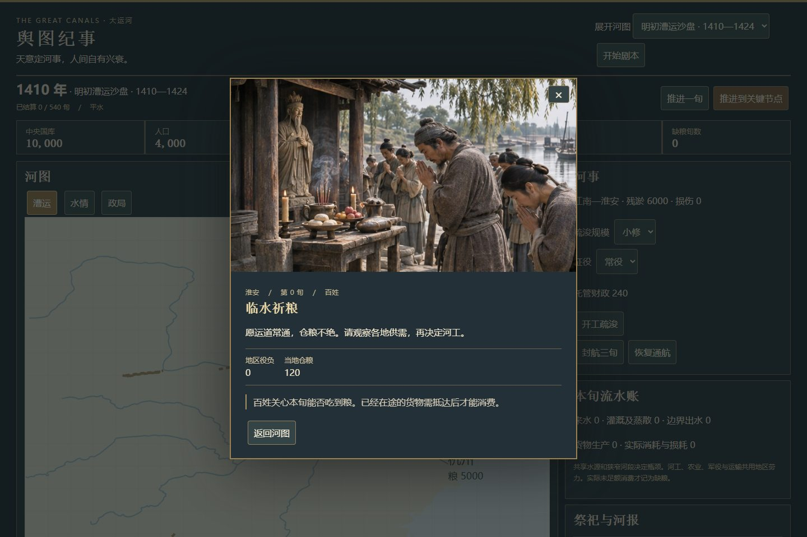

# The Great Canals · 大运河模拟器

玩家化为天意，决定运河建设与经营；人间各方自主行动、争用资源，并通过祭祀表达诉求。

当前提供可运行的网页游戏原型，包含「舆图纪事」带图版本、原版界面和两岸教学试局。玩家通过运河决策应对自主变化的人间局势。

## 带图版本

代码和 **30 张写实 CG** 均包含在本仓库中，图片无需在线生成或另行下载。地图上的事件旗标可以点击，展开 CG、事件文字与发生时的局势快照；运河动作与五种结局也有对应场景。

```powershell
cd grand-canal-game
npm ci
npm run dev
```

打开终端显示的地址，在地址后加 `/atlas.html` 进入带图版本；`/` 为原版，`/trial.html` 为教学试局。项目声明的运行环境为 Node.js 24.15.0、npm 11.12.1。

部署静态站点时，在 `grand-canal-game` 下运行 `npm run build`，发布整个 `dist` 文件夹（包括 `cg`），从 `/atlas.html` 进入。不要直接双击源 HTML。



图片位于 [grand-canal-game/public/cg](grand-canal-game/public/cg)，通过网页版 ChatGPT 生成并切分为独立 JPEG。历史衣冠与建筑属于情境演绎；当前游戏为原型，不代表全部历史长剧本与需求均已完成。

## 设计与资料

- [文档总入口](grand-canal-game/README.md)
- [需求文档](grand-canal-game/docs/01-requirements.md)
- [架构设计](grand-canal-game/docs/02-architecture.md)
- [新增隋前—隋唐—五代十国剧本](grand-canal-game/docs/05-sui-tang-campaign.md)
- [各模型与 Agent 执行合同](grand-canal-game/docs/06-agent-execution-contract.md)
- [美术规范](grand-canal-game/docs/03-art-direction.md)
- [Codex / DeepSeek Harness 配置](grand-canal-game/docs/04-model-and-harness-guide.md)
- [具体执行计划](grand-canal-game/docs/superpowers/plans/2026-11-02-grand-canal-mvp.md)
- [历史地图与史料](grand-canal-atlas/README.md)

开发 Agent 先读 [AGENTS.md](AGENTS.md)。所有年份窗口、试玩时长与数值目标的性质在文档内标注；不得将游戏参数当作史实。
