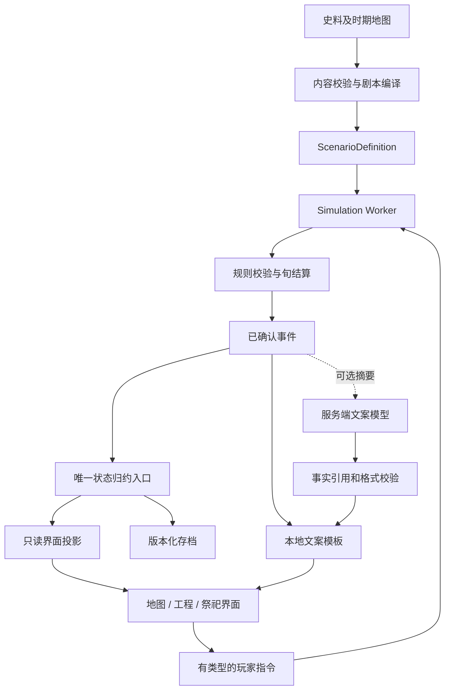

# 大运河游戏架构设计

版本：v0.1　日期：2026-11-02　依据：[需求 FR-01—FR-13](01-requirements.md)

## 1. 架构决定

采用本地优先的单体应用：React 地图界面、Web Worker 中的确定性 TypeScript 模拟内核、JSON 剧本与 IndexedDB 存档。可选在线文案通过独立的轻量服务接入。首版不需要微服务、向量数据库、实时多人服务器或大模型驱动的世界状态。

现有 `murder-loop-ai` 使用 TypeScript / React / Vite，可复用团队经验；新游戏在 `grand-canal-game` 自有 package.json 和锁文件中运行，不导入悬疑游戏的人物、回合状态或裁决链。相邻 atlas 是只读史料输入，不能直接充当模拟地图。

技术基线：TypeScript strict、React + Vite、原生 Web Worker、SVG 地图、IndexedDB、Vitest；浏览器流程用 Playwright。在 T01 选择兼容的稳定依赖并锁定实际版本、Node 版本和 package manager；既有项目版本仅作经验参考，不自动当作最新版本。地图初期规模小，先用 SVG；只有实测渲染成本不满足目标时才把几何绘制迁至 Canvas。

## 2. 总体数据流



以下文件和接口是实施目标，本次文档交付没有生成应用代码。

```text
grand-canal-game/
  package.json / package-lock.json / tsconfig.json / vite.config.ts
  content/
    evidence/                         # 史实与出处，仅导入必要条目
    scenarios/ming-1410.json          # 玩法地图、规则参数、起始状态
    templates/zh-CN.json              # 无 AI 时的完整叙事
  src/
    core/
      types.ts                       # 对外领域类型及数值单位
      createGame.ts                  # 起始状态与数据校验入口
      commands.ts                    # 指令校验及事件生成
      reducer.ts                     # 已确认事件的唯一状态写入
      rng.ts / invariants.ts          # 随机流与守恒约束
      calendar.ts / advance.ts        # 旬与关键节点推进
      actors.ts / labor.ts            # 人间事务、承诺、劳役
      projects.ts                    # 工程进度、维修、退出
      water.ts / transport.ts         # 双网络与聚合货流
      economy.ts / petitions.ts       # 地区影响、祈愿聚合
      endings.ts / preview.ts         # 结局、隔离预览
      tick.ts / index.ts              # 结算编排与稳定导出
    content/schema.ts / loadScenario.ts / devScenario.ts
    worker/protocol.ts / simulation.worker.ts
    persistence/saveCodec.ts / saveStore.ts
    presentation/viewModel.ts / templates.ts / narration.ts
    ui/App.tsx / MapView.tsx / ProjectPanel.tsx
    ui/PetitionPanel.tsx / Timeline.tsx / EndingPanel.tsx
    ui/theme.css
  server/narration.ts                 # 可选阶段才创建
  scripts/importAtlas.ts / runBalance.ts
  tests/core/ / tests/content/ / tests/e2e/
  assets/manifest.json
  docs/
```

## 3. 数据层与领域对象

### 3.1 三层内容

|层|核心字段|规则|
|---|---|---|
|EvidenceRecord|id、claim、sourceUrl、timeRange、originalUnit、confidence、limitations|保留原单位和不确定性，未知值为 null|
|ModelAssumption|id、mechanism、evidenceIds、scope、rationale|记录从史料到机制的推论|
|BalanceParameters|version、values、units、trialResults|仅游戏系数，禁止被展示成史实|

导入 atlas 时保留工程 ID 与来源；从示意线提炼的是候选走廊关系。独立补录高度等级、供水关系、通航条件、实际连接、工程长度依据。不得直接从示意 GeoJSON 折线量取“古代工程长度”。

### 3.2 核心对象

|对象|职责与必要状态|
|---|---|
|RegionState|人口、农业能力、可用劳动、役负、粮储、地方关系及税源指标|
|ActorState|中央/皇室/地方/社会群体的目标、资源、执行能力、承诺和当前事务|
|WaterNode / WaterEdge|水量储存、来水、灌溉/蒸散、泄水、上下游及可用设施|
|TransportNode / TransportEdge|仓储/转运节点、可航条件、方向成本、容量、旅行旬数|
|CanalReachState|跨两张网络的河段身份、规格、淤积、损伤、维护制度及有效时期|
|ProjectState|阶段、已完成劳动、物资与资金、未来承诺、征发来源、工期预测|
|PreservationLiability|已停工但未安全处置的实体河段、责任主体、保全预算与退出工作|
|Commitment|承诺者、资源归属、金额/劳动量、到期时段、硬承诺或可撤回承诺|
|Demand / ShipmentBatch|自动需求和聚合在途批次；用途、数量、路线、下一节点、旅行进度|
|Petition|主体立场、事实引用、议题键、相关河段、紧迫性及已响应状态|
|DomainEvent|事件 ID、旬、类别、来源、因果父 ID、已确认的差量与显示事实|

所有实体用稳定 ID，相同历史名称在不同时期可对应不同实体。数量使用安全整数或规定倍率的定点整数。LaborUnit 表示模型人日、WaterUnit 表示抽象水量、LoadUnit 表示标准运力占用、TreasuryUnit 表示剧本财政单位；不能把它们直接展示为史书中的“工”“石”“锭”或现代货币。

### 3.3 状态与外部接口

```ts
type EntityId = string;
type Tick = number; // 从剧本开始起的旬序号
type MaintenancePolicy = 'minimum' | 'standard' | 'intensive';
type PassagePolicy = 'balanced' | 'official_first' | 'civil_first';
type WaterPolicy = 'balanced' | 'navigation_first' | 'irrigation_first';
type LoadClass = 'small' | 'standard' | 'heavy';
interface PassageSchedule {
  official: number[];
  civil: number[];
  trade: number[];
} // 每个数组为允许通行的年内旬序号 0..35，按用途分组。

type PlayerCommand =
  | { type: 'PLAN_PROJECT'; projectKind: 'build' | 'dredge' | 'upgrade' | 'reroute';
      reachIds: EntityId[]; grade: 'small' | 'standard' | 'heavy';
      laborMode: 'normal' | 'urgent'; startTick: Tick; sponsorIds: EntityId[] }
  | { type: 'SET_PROJECT_STATUS'; projectId: EntityId; status: 'paused' | 'active' | 'cancelled' }
  | { type: 'SET_MAINTENANCE'; reachId: EntityId; policy: MaintenancePolicy }
  | { type: 'SET_PASSAGE'; reachId: EntityId; policy: PassagePolicy;
      maxLoadClass: LoadClass; schedule: PassageSchedule; closedUntil: Tick | null }
  | { type: 'SET_WATER_POLICY'; nodeId: EntityId; policy: WaterPolicy }
  | { type: 'SET_REACH_STATUS'; reachId: EntityId; status: 'active' | 'mothballed' | 'decommissioning' };

interface CommandEnvelope {
  commandId: string;
  expectedRevision: number;
  command: PlayerCommand;
}

type CommandErrorCode = 'STALE_REVISION' | 'DUPLICATE_COMMAND' | 'INVALID_TARGET'
  | 'INVALID_PHASE' | 'INVALID_TIME' | 'INSUFFICIENT_COMMITMENT' | 'INFEASIBLE_ROUTE';

interface CommandError { code: CommandErrorCode; message: string; relatedIds: string[] }
interface StepResult { state: GameState; events: DomainEvent[] }
type CommandResult =
  | ({ ok: true } & StepResult)
  | { ok: false; state: GameState; error: CommandError };
interface AdvanceOptions { untilTick: Tick; maxTicksPerChunk: number }
interface AdvanceResult extends StepResult {
  stoppedBy: 'decision' | 'target' | 'chunk' | 'ending';
}

// GameState 与 ScenarioDefinition 包含上表中的实体集合，完整字段在 T01 落成。
// GameState 还必须含 revision、tick、scenarioVersion、rulesVersion、rngStates、
// appliedCommandIds、pendingEvents、inTransit、ending。
function createGame(scenario: ScenarioDefinition, seed: number): GameState;
function applyCommand(state: GameState, envelope: CommandEnvelope,
  scenario: ScenarioDefinition): CommandResult;
function tick(state: GameState, scenario: ScenarioDefinition): StepResult;
function advanceToDecision(state: GameState, scenario: ScenarioDefinition,
  options: AdvanceOptions): AdvanceResult;
function preview(state: GameState, command: PlayerCommand,
  scenario: ScenarioDefinition): PreviewResult;
function hashState(state: GameState): string;
```

这些签名是接口契约，不是可直接独立编译的源码。T01 为上述实体定义完整类型与校验，再分模块实现，避免各执行者自行发明不同字段。PreviewResult 含可行性、确定投入、预计工期上下界、影响摘要与未知因素；不包含可写入正式状态的对象引用。

通航日程默认每种用途均包含 0..35，空数组表示该用途全年不通行；临时 closedUntil 优先于年度日程，到期自动恢复日程。重叠时窗仍按 PassagePolicy 竞争共享容量；界面用预设“全年开放/季节开放/官民错峰”编辑日程，不要求逐旬逐船操作。maxLoadClass 是抽象船载等级限制，系统可以通过拆批/换装适配并计入成本和时间；它不等于修改整条河的总容量。非法序号、重复序号或非 null 且不晚于当前旬的 closedUntil 均返回 INVALID_TIME；立即解除临时关闭使用 null。

## 4. 单一写入、确定性与预览

`applyCommand` 先检查 revision、重复 ID、目标、时间和资源承诺，生成事件，再交给 reducer 应用。失败保持状态、随机流和 revision 不变；重复提交返回明确错误，不再次扣款。

每旬的各模块也是“读状态 → 提议事件 → 校验 → reducer 生成下一阶段状态”。一整旬作为原子事务提交；违反守恒约束时回滚本旬并保存诊断信息，不能静默修正为零继续运行。

所有影响模拟的循环按稳定 ID 排序。禁止使用 Date.now、Math.random、网络返回顺序或渲染帧率决定结果。天气、人物事务、灾害使用分离的种子随机流；文案与视觉随机另存，且不计入模拟哈希。哈希覆盖可影响未来的模拟状态、版本、随机流与队列，剔除 UI 选择、真实时间戳和文案缓存。

预览在副本上运行，不能改变正式随机流。已知工程费用使用确定值；未公开天气与人间决定用明确的低/中/高假设估算，不能读取真实未来随机结果变成预言。界面展示投入、结果区间和区间的依据。

## 5. 时间、世界行为与旬结算

### 5.1 简化日历

每年 12 月，每月三旬。GameState.tick 表示已经完成的旬数，`tick=0` 为 1410 年初，`tick=540` 为 1425 年初的结束边界。调度事件的 effectiveTick=k 在第 k 次旬结算（k-1→k）的第一阶段生效，结算后状态为 k；开局已存在的事务直接写入初态。由此，effectiveTick=4 的可响应变化必须在 3→4 结算后停下，不能到 5 才报告。历史事件只精确到年份时在内容中保留年级精度，不能编造确切日子。

`advanceToDecision` 按旬调用 tick，检测是否出现需要回应的事件、到达目标、出现结局或达到分块上限。分块是性能机制，不是玩家回合；Worker 每块返回进度，主线程可以发出中止。下次继续必须与一次完整推进完全等价。已结束状态的 tick 返回原状态及空事件；推进立即返回 ending，不能继续生产、消耗或改变结局。

### 5.2 每旬的固定顺序

1. **读取已生效的日历事件和世界状态。** 天气、军事/宫殿意向的阶段变化、人间资源承诺变化生效。新自主行动基于上旬状态决定，避免在同旬反复自激发。
2. **计算水源和可用劳动。** 处理本旬来水、设施状态、用水预算、人口可劳动比例与农业季节保护线。
3. **分配承诺与劳动。** 军役、其他工程、河工、运输和必要生产共享上限；已计划的未来劳力只是预约，不保证外部行动后仍足额。
4. **生产与工程。** 根据实际劳动、水和库存产生粮食、工作量、支出及农业劳动缺口；工程在旬末完成，新能力从下一旬开始。
5. **自动运输。** 读取当前可航条件与库存，创建/推进聚合运输批次，扣减共享运力；根据实际过闸批次登记水量转移。
6. **消费、财政与社会影响。** 送达物资进入对应地区库存，计算消费、短缺、相关税源、役负、迁移及风险变化；消费不能抢先使用尚在途的货物。
7. **维护、淤积、设施损伤与风险。** 已知季节来水在第 1 步进入；本旬运作造成的新损伤和期末抽样灾害在此记录。若灾害需要响应，则在下一旬使用受损设施前停止。
8. **祈愿、停点、结局和存档标记。** 按事实聚合议题，检测持续阈值与冷却，输出可查原因链。

因果影响在同旬或下一旬的生效时点必须固定在规则版本中。首版避免在一个旬内递归求任意次数的经济均衡；若模型偏差导致错误玩法，再经测试修改。

### 5.3 人间行动

首版为可复现的条件规则与阶段机：`proposed → mobilizing → active → completed/cancelled/escalated`。每个行动有启动条件、持续占用、承诺撤回规则、需求变化、地区代价与结束条件。

同一战争既可以征用劳力，也能创建军需需求；两者引用同一行动 ID。主体选择通过配置权重和有限随机扰动完成，LLM 不决定是否战争或从哪里扣资源。历史事件配置分为外生背景、条件事件、已知节点；不强制播放已失去条件的事件。

## 6. 劳动、财力与项目

### 6.1 资源预算

地区劳动硬上限由可劳动人口、本旬天数和可用比例计算；疾病、远征、迁移等通过实际状态影响它。农业保护量是劳动需求，不是额外资源。默认按保护线分配；加急只能在硬上限内转移劳动，未满足农业需求的部分形成生产损失。

劳动账本记录 `{regionId, actorId, activityId, requested, allocated, unmet}`。全体 allocated 之和不得超过上限。役负按每个来源地区的实际征发强度、连续期数和恢复条件累计；出生、死亡、迁移通过独立事件更改人口。

首版采用以下明确的分层分配规则，属于可更改的游戏基线，不声称各朝历史制度完全一致：

|顺序|劳动请求|未足额的后果|
|---|---|---|
|0|基本生活必要劳动|不得主动转拨给工程；人口健康造成硬缺口时记录民生风险|
|1|已动员的强制军役、应急抢险、玩家选择的加急河工|按同层规则分配；可以挤占后续农业，实际挤占形成误农|
|2|本旬农业保护需求|未满足部分进入生产损失，不凭空补回|
|3|维持既有运输和设施的基本运行/最低维护|实际配额约束本旬可用运输和保全能力|
|4|宫殿、普通地方工程、正常河工和额外养护|按同层规则分配，未满足部分成为延期|

同层按 `有效请求 × allocationWeight` 比例分配，达到本项请求上限后将剩余量再次按比例分给未满足者；整数余数按最大余数、再按 activityId 排序分配。weight 由剧本记录，默认 1；有效请求不得超过项目在本旬能够实际利用的劳动量。权重只影响同层分配，改变行动层级必须有明确的动员事件。任何后来模块不能绕过配额追加劳力。

例如，扣除生活劳动后有 100 单位，农业需求 60，已动员军役 30，宫殿与正常河工各请求 20：先军役 30，再农业 60，余下 10 在等权的宫殿/河工之间各分 5。无军役时两项各获 20。军事请求若达 70，农业只获 30，其余工程无配额；由此产生的减产明确归因于该动员。

运输和最低维护的请求根据本旬可用设施、待发及在途批次预估，实际能力不得超过已获配额；未用配额本旬闲置，下一旬重新分配，不在同旬循环挪用。异地劳役设置到场延迟和工粮需要，尚未到场不计入已完成工作。

资金承诺区分“已托管可用”与“未来预计拨给”。项目提交锁定本期可用额度，后续拨给可以改变；未花额度退回原出资方，已用额度不退。粮食和物资绑定地区库存，运输到工地后才能消耗。

### 6.2 生命周期

工程状态与运营河段分开：项目进度变化不立即等于通航能力。试航通过后才增加有效能力；分段完成只对已连接且满足条件的部分生效。

暂停保留已完成工作，发生保全与逐期退化；恢复需要按现状估算。封存与退出显式承担最低水工安全责任。改道创建新项目并链接旧道处置，不能偷偷删掉旧道的维护债务和地区影响。

取消未开工计划只释放未使用承诺。取消已施工项目会停止原建设目标，同时将实体河段移入“待处置”状态并建立 PreservationLiability：记录 reachId、责任主体、最低保全请求与安全退出所需工作。必要保全预算先从未花额度中保留，其余再退回原出资方；预算不足记录缺口和风险。责任随河段存档，必须由封存保全、恢复施工或完成退出处置解除，不能因为 ProjectState 为 cancelled 而消失。预览和界面把这种操作写为“停工并处置”，列出新增责任。

## 7. 双网络与后台物流

### 7.1 水网络

水网络用有向边、节点水位等级、储水上限和受控出水表示。水量守恒账本：期初储量 + 来水 = 期末储量 + 流出边界 + 蒸散/渗失 + 取用；内部节点间转移不计为全网消耗。

过闸释放的水进入对应下游节点；不能在全网把它既当“耗掉”又加到下游，亦不能让同一份水无限循环生运力。调度先给出允许的闸次/补水预算，运输阶段按实际通行扣用并结算水的去向。首版水网络按地势构成可处理的有向关系；设计环路必须有明确流向与状态边界。

水量参数使用抽象单位；没有史料流量时不声称其为真实立方米。枯水水源保障、汛期风险、闸次与农业取水提供主要决策深度。

### 7.2 运输网络

每条运输边具有方向、通行季节、承载等级、每旬容量、旅行旬数、损耗与成本。天然河道、人工运河、短驳和海路都是运输边，但设施与风险不同。地区还受换装节点容量约束。

Demand 由生产/消费和行动规则产生；用途影响政策优先级，物资计算仅保留满足供给守恒所需的粮食与通用物资/商业供给指数。市场价格不是首版独立模拟系统。

每条需求记录 requested、fulfilled、reservedInTransit、cancelled 及状态；可继续派发量为 `max(0, requested - fulfilled - reservedInTransit - cancelled)`。同一主体/地区、用途和需求期次使用稳定 demandKey，重复事件不重新生成同一需求。周期消费可以产生下一期的新需求，但不能把上一期的在途占用忘掉。

发运同时占用需求与扣除源库存，批次保存 demandId；送达把 reservedInTransit 转为 fulfilled。途中损耗减少该占用，需求仍有效时允许补发，否则记为到期未满足。拆批只拆分同一占用，不新建承诺。需求取消后停止新发；已经发出的物资先到达下一可停靠节点，再按显式事件转交另一条有缺口的需求或回到原所有者库存，同时释放/关闭原占用，不能令货物凭空消失。每个交付事件按批次与交付量防重。

按政策优先级、紧迫性和稳定 ID 排序分配需求，寻找可行低综合成本路线；共享边和转运节点逐项扣减剩余能力。限制一个旬内的重路由次数，避免边际成本变化反复震荡。

运输以批次移动，不绘制每艘船的真实状态。ShipmentBatch 保存数量、所有权、用途、路径、当前路段与剩余旅行旬数；拆批保留父 ID，库存减去已发运量。在每个节点重新检查下一段能力，等待也消耗时间。灾害只影响实际受影响批次，可停航、损失或转运，不能同时在起点与目的地各算一份货。

后台可显示聚合箭头和原因分解。路线运量受到当前真实需求限制，空闲运河没有无条件商税；运河的新增能力只在被实际使用时改善供给或经济。

## 8. 祭祀、投影与可选 AI

祈愿的议题键为 `{regionOrReach, issueType, causeRootId}`；同议题汇集多个群体声音。事实稳定时只更新紧迫度，不新建重复弹窗。是否打断由影响大小、时间敏感性、是否存在玩家动作共同决定，冷却期限由配置控制。

ViewModel 从正式状态产生：地图图层、工程卡、祈愿、运输趋势、役负与原因。UI 只有临时选择/草稿状态，不自行计算另一份“真实粮食”或直接写进度。

AI 是增强文案的可选步骤。输入限于已确认事件摘要、可展示事实 ID、时期词汇表和主体立场。输出仅包含 `{voice, eventIds, text}`，禁止返回状态修改指令。数字、地名和结局标签优先由程序模板插入；无法校验的历史判断丢弃。AI 响应延迟、失败或版本过期时保留模板，正式模拟不等待模型。

若启用在线文案，服务端限制请求规模和频率、设置超时，按事件摘要哈希缓存。展示文本作为纯文本渲染；来源/祈愿文本不是工具指令。游戏内模型不能使用文件、网络搜索或执行代码工具。开发用 DeepSeek Harness 与游戏内文案服务是不同系统。

## 9. Worker、存档与错误处理

Worker 请求包含 requestId、sessionId、expectedRevision 和 payload。预览、推进和正式指令排队；过期结果不能覆盖新状态。推进收到中止时在旬原子提交边界停下。

SaveEnvelope 保存 formatVersion、rulesVersion、scenarioId/version、contentHash、模拟快照、随机状态、未完成队列、最近事件与校验摘要。自动档取抵达停点、该旬原子提交完成后且玩家下一指令之前的状态；最近稳定快照用于故障回退。需求在途占用、停工保全责任与通航日程均必须保存。长局按关键节点增量保存并定期快照；事件可分段归档，保留结局需要的累计统计和因果索引。IndexedDB 写入失败时保持内存局面，并提供导出恢复文件。

导入先校验版本、大小、结构、ID 引用、数量范围和摘要。迁移函数显式声明 from/to；没有迁移路径则拒绝载入并提示原版本，原文件不改写。文本显示与数据执行分开，不把存档字符串作为脚本运行。

|失败情形|处理|
|---|---|
|指令过期/重复|拒绝且不扣资源，界面刷新当前 revision|
|工程前提或资金不足|返回具体缺口，可重新预览较小方案|
|模拟守恒失败|回滚本旬，提供诊断与上一稳定存档|
|图层或史料条目缺失|标示未知/缺图，保留有依据的规则；关键剧本引用缺失则禁止开局|
|模型超时/无依据文案|继续使用本地模板|
|存储空间不足|提示导出，不能显示“保存成功”|

## 10. 验证与需求映射

|模块|需求|关键验证|
|---|---|---|
|commands/projects|FR-01/04/06|重复提交、无资源、取消与恢复、非瓶颈扩建|
|actors/labor/economy|FR-02/05/09|战争与宫殿争用、农业挤占、人口/劳役分离|
|calendar/advance/tick|FR-03|跳时/单步结果一致，中间危机停点，分块可中止|
|water/transport|FR-07/08|水/物资守恒、共享瓶颈、真实旅行时间与备用线路|
|petitions/presentation|FR-10/11|议题合并、立场差异、事实可查|
|endings/persistence|FR-12/13|累计与末期评价、遗产区分、同种子复现与损坏导入|
|worker/ui/templates|NFR-01—06|离线通关、响应性能、低分辨率与无色彩依赖|

数值实验采用相同气候/外部行动种子比较策略；记录送达率、缺粮持续期、役负分布、设施状态、财政与中断次数。使用正常/旱/洪/征兵/宫殿组合条件，不要求所有错误策略均能存活。

核心先用极小人工案例验证守恒与因果，再对首局做批量实验，最后由真人试玩验证理解和趣味。实现目标与测试命令见[执行计划](superpowers/plans/2026-11-02-grand-canal-mvp.md)。

## v0.2 战役与多政权扩展

需求依据：[长剧本 FR-14—FR-19](05-sui-tang-campaign.md)。本节将前文固定明初日历限定为该剧本实例，共享内核不得硬编码 1410、540 或单一中央。

新增 CampaignDefinition（id/version/chapterIds/startYear/endYearExclusive/endPolicy）、ChapterDefinition（timeRange/initialSnapshotRef/transitionRules/technologyProfile/mapProfile）、WorldTransitionPlan（前后主体、地区/资产/承诺/通行权映射）、AccessRight（运输边、允许主体、有效期、撤销事件）与 SovereignState。endTick 从具体剧本计算：明初为 540，长战役为 15480。

新增 core/campaign.ts、ownership.ts、access.ts，content/campaigns/sui-tang-550.json，content/scenarios/sui-tang/*.json；由 A 维护共享类型/调度，B/C/D/E 按 Agent 合同提供模块实现。saveEnvelope 增加 campaignId/version、chapterId、sovereignStates、权属与通行权版本；已有明初存档通过显式迁移补入单主体默认值，未知规则版本拒绝导入。

连续切章先生成权属转移事件，再核验地区库存、在途占用、设施和责任没有复制或丢失，原子提交后更换时代内容投影。地理有效性按实际世界状态叠加时段基线，不能用一张新地图覆盖玩家建设。没有归属映射的资产进入争议托管。政治边界变化限制运输通行，而不切断物理水流；跨境开闸影响仍沿水网传播。

长期推进继续逐旬计算，性能分块不改变随机流；章末保存累计统计和因果索引，事件按章节归档。世界行动按活跃政权执行，资金不可跨主体任意挪用。结束判定通过 endPolicy 区分 single-polity 与 campaign：前者保留明初危机规则，后者在主体覆亡后优先执行继替，至观察期末或另有明确无恢复条件才结束。

新增验收：完整/分块 15480 旬哈希一致；切章前后资产总账相等（显式损毁除外）；边界关闭不复制货物；王朝覆亡不清零役负、停工责任与维护债务；早期章没有后期设施能力。实施顺序 C01—C05 见长剧本规格。
