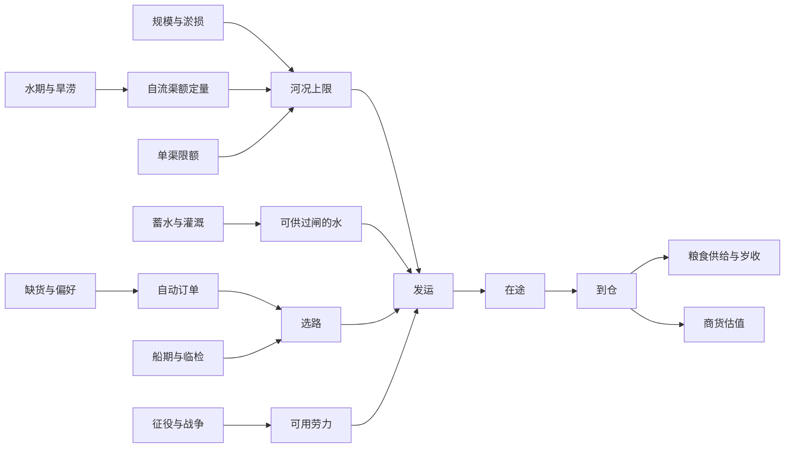

# 运河数值手册 · 舆图版
本表约定载、工、财政单位和旬。它们是游戏单位。所有计数取非负整数，一年 36 旬，一月 3 旬。教学事件按已结算旬数触发，于下一次结算生效。

| 环节 | 参数、结算及影响 |
|---|---|
| 旬初水期 | 1–2、11–12 月枯水系数 0.7，5–8 月丰水 1，其余平水 0.9。自流渠另遇枯水年景再乘 0.6。开闸航段由可用闸水限制。 |
| 额定运量 | 初始边容量 × 自流水情系数（有闸取 1）× 本段限额，向下取整。限额可独立设为 0%、25%、50%、75%、100%。 |
| 淤积与损伤 | 河况上限 = floor(额定量 × 规格 × (1−淤积率) × (1−损伤率))。小、中、大规格系数 1、1.25、1.6。内部万分数 6000 显示为 60%。满淤或完全损坏不能发船。 |
| 清淤 | 小、中、大修分别去掉现有淤量的 40%、70%、90%（去除量向上取整）。60% 淤积经小修变 36%，无损伤小渠的百载上限由 40 增至 64。 |
| 工程 | 小、中、大基础工量 240、480、960。开新渠、清淤、拓宽或收窄、改道分别乘 1.5、1、1.2、1.8。每工消耗财政、粮、料各 1。完成后试航 1 旬，随后计入运网。 |
| 实际发船 | 船期、辖境、状态先判可走；可发量受需求缺口、产地库存、河况余量、码头、劳力、闸前水位和可释放水量共同限制。水闸按载耗水，自流渠不逐船耗水。 |
| 并行河段 | 先选准入且成本低的路径。一条路不足时，同笔需求会尝试其他出发边。需求很小时最便宜的渠可独运；限额是上限，并非必须完成的份额。途中船仍驶向原定节点。 |
| 货类与民生 | 粮和商货分库存、分订单。南仓或江南生产盐货，用统一商品单位记账；每旬产量为当地实际农业产出的三分之一向下取整。材料另作工程耗材。只有粮食欠供计为缺粮。 |
| 地域市场 | 北岸需求 6 商货/旬，正式局淮安 5、京畿 12。目标库存为 3 旬消费。未覆盖需求 = max(0,目标−仓内−同类在途)，自动从产地订货。近市每载到仓货值 5（基础 2＋偏好 1＋基准路程 2），远市为 9（2＋3＋4）。绕行不抬价。货值计入成交统计，当前不直接转入国库。 |
| 平级与保粮 | 同渠放行商船时，奇数旬粮先发，偶数旬商货先发，同类按订单编号。仅粮令禁止该渠新发商货，仍可走别渠。政策不会卸掉已上船的货。 |
| 账本 | 按河段分别展示上旬发出的粮、商货与累计发运；在途量是当前库存快照。运经两段会分别计两次发运，到仓仅计一次送达。每年基础税归所属政权，中央另收 floor(全年送达粮 / 10)。军役、营建、维护按旬支出。 |
| 教学事件 | 第 3 旬末旱情令源头存水、来水减半，第 12 旬末恢复常年入流。第 23 旬末北岸临检旧渠三旬，第 26 旬末解除。军役另按剧本征人和支款。 |

**可复现算例**　两岸试局，开局即小规模开挖东汊。第 37 旬末将东汊限额设为 0%，旧渠 100%；第 47 旬末互换。默认种子下，前十旬旧渠累计发运由 225 增至 385，新渠维持 326；后十旬新渠由 326 增至 486，旧渠维持 385。两段各承担 160 载，粮商均包含在内。

以上市场需求、基准路程、季历与价格用于关卡平衡，均非历史报价。逐项原始参数见 src/trial/scenario.json，地域覆盖见 src/trial/scenarios.js。

